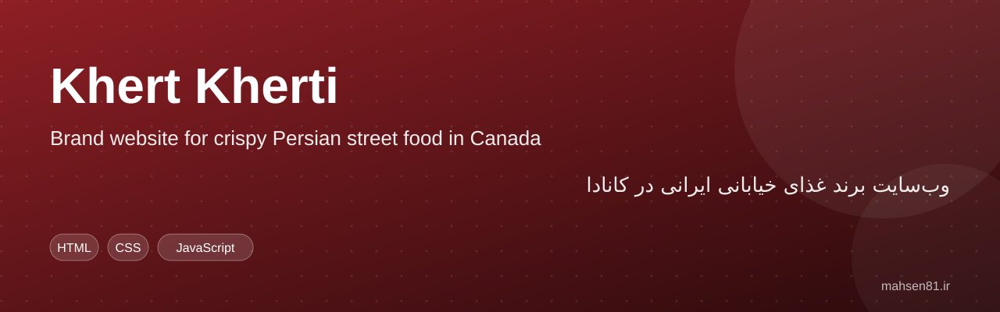

<!-- gen:header -->
<p align="center"></p>

<h1 align="center">Khert Kherti</h1>
<p align="center"><b>وب‌سایت برند غذای خیابانی ایرانی در کانادا</b><br><i>Brand website for crispy Persian street food in Canada</i></p>
<p align="center">  </p>

<div dir="rtl">

## ✨ امکانات

- معرفی منو: کوکو سیب‌زمینی، سمبوسه و کتلت
- طراحی واکنش‌گرا و سریع
- سئوی محلی

</div>

## 🚀 Quick start

```bash
Open site/index.html or deploy site/ to any static host.
```

---

<p align="center">ساخته‌شده توسط <a href="https://mahsen81.ir"><b>محسن جباره‌اصل</b></a> — برنامه‌نویسی، طراحی سایت، ربات و هوش مصنوعی<br>
Built by <a href="https://mahsen81.ir">Mohsen Jabbareh-Asl</a> · ⭐ اگر مفید بود، ستاره بدهید · Need a custom version? <a href="https://mahsen81.ir">Get in touch</a></p>
